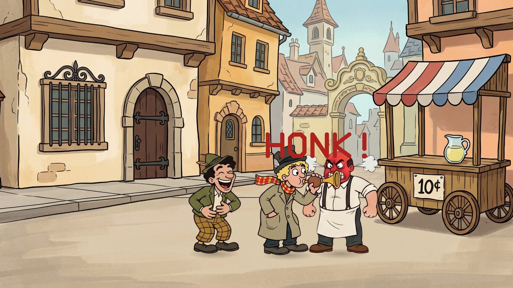
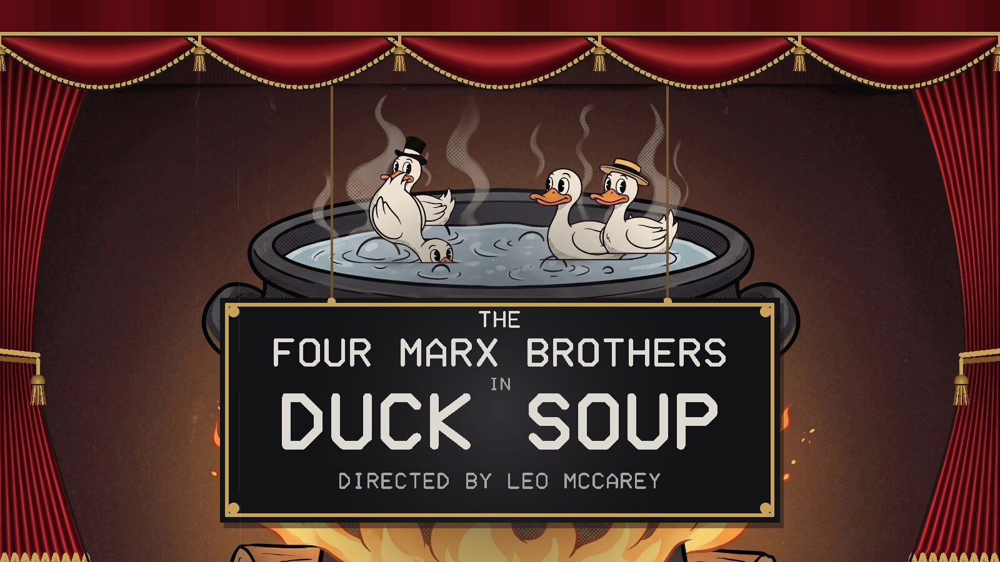
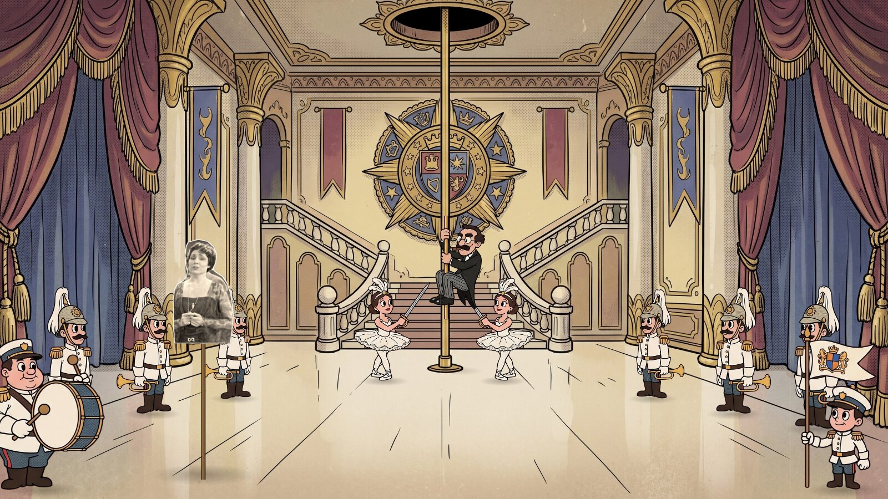
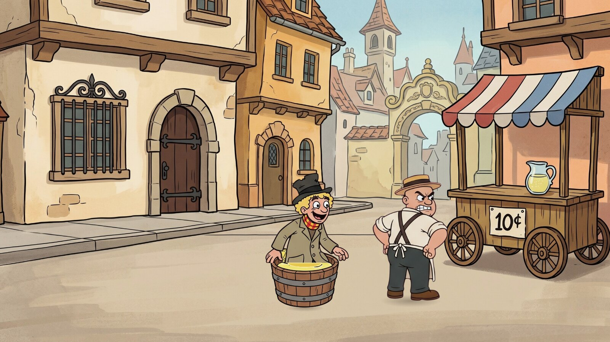
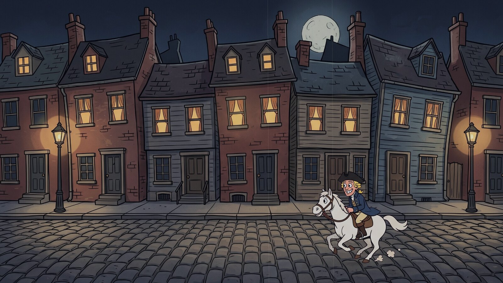
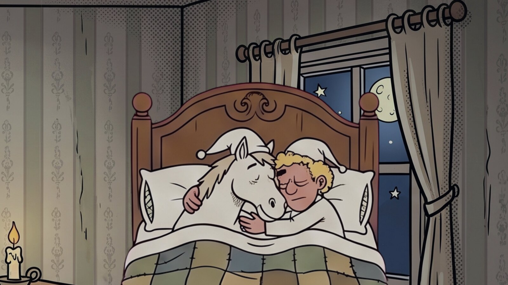
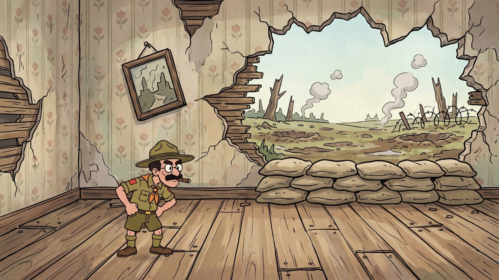

# Duck Soup

A cartoon screensaver of the sight gags from the Marx Brothers' *Duck Soup* (1933),
one after another in the order of the film, with title cards, an iris in and out,
and old band records for music. Runs on Linux, Windows and macOS. One of the
[Marx Brothers screensavers](https://github.com/mottipython/marx-screensavers).

## What it shows

About six minutes, then it begins again:

- **The titles**: four ducks paddling in a pot over the fire, the curtain going up
  on them and the film's own title card let down on ropes.
- **His Excellency arrives**: the guards blow their trumpets at the staircase, and
  Rufus T. Firefly comes down the fireman's pole instead, joins the end of the line
  to wait for himself, and bows to Mrs. Teasdale, a cut-out of the real Margaret
  Dumont on a stick, who has been tapping it impatiently all along.
- **The lemonade stand**: the hat shuffle, a honk in the seller's face, a leg in
  his hand.
- **The lemonade stand again**: Harpo paddling in the lemonade, and the seller's
  straw hat set alight.
- **The radio** that will not stop playing, until Harpo backs into the big mirror.
- **The mirror**: the broken-mirror gag from
  [The Mirror Scene](https://github.com/mottipython/mirror-scene), with Chico
  walking through at the end.
- **Paul Revere's ride**, and **Good night**: Harpo in bed with the horse.
- **The war**, fought in a new uniform every time we look.
- **The curtain call**, and the tomatoes.

Between every two, the sidecar gag: the motorcycle goes off without the sidecar, or
the sidecar goes off without the motorcycle.

| | |
|---|---|
|  |  |
| The titles | Down the pole |
|  |  |
| The sidecar | In the lemonade |
|  |  |
| The mirror | The ride |
|  |  |
| Good night | The war |

## Install

Packages are on the [releases page](../../releases).

### Windows

For Windows 10 or 11, step by step:

1. [**Download Duck Soup**](https://github.com/mottipython/duck-soup/releases/latest/download/DuckSoup-Setup-1.0.0.exe).
2. If the browser says the file "isn't commonly downloaded" or "could harm your
   device", click the **⋯** (or **^**) beside it and choose **Keep**, then **Keep
   anyway**.
3. Open the downloaded file (click it at the top or bottom of the browser, or find
   it in the **Downloads** folder).
4. A blue box may say **"Windows protected your PC"**. Click **More info**, then
   **Run anyway**. (It says this because the program isn't signed with a paid
   certificate, not because anything is wrong with it.)
5. Windows asks **"Do you want to allow this app to make changes?"** Click **Yes**.
   (Windows only lists screen savers kept in its own system folder.)
6. Click **Next**, then **Install**, then **Finish**. The Screen Saver Settings open
   with "Duck Soup" already chosen. Click **OK**.

It comes on by itself when the computer has been left alone. To pick a different
one later, type **screen saver** in the Start menu search and open **Change screen
saver**. To remove it, open **Settings**, **Apps**, find it in the list and choose
**Uninstall**.

### macOS

For Apple Silicon and Intel, macOS 11 or later. Paste this into Terminal; it installs
the screen saver for your user and opens the Screen Saver settings:

    curl -fsSL https://raw.githubusercontent.com/mottipython/marx-screensavers/main/tools/mac-install.sh | sh -s -- duck-soup

Or download the file ending `-mac-screensaver.zip` from the releases page, unzip it
and double-click the `.saver` file. It is not signed with an Apple developer
certificate, so macOS will refuse it at first: open System Settings, Privacy &
Security, and click Open Anyway.

### Linux

**Fedora, Nobara** (built on Fedora 44):

    sudo dnf install ./duck-soup-1.0.0-1.fc44.x86_64.rpm

**Debian, Ubuntu, Mint** (Ubuntu 24.04 / Debian 13 or later):

    sudo apt install ./duck-soup_1.0.0_amd64.deb

From your next login it starts by itself after five minutes idle on Wayland desktops
that provide ext-idle-notify (KDE Plasma, Sway, Hyprland, niri, COSMIC, labwc and
others), and any key or mouse movement ends it. `duck-soup-screensaver` changes the
delay or turns it off. If
[screensaver-service](https://github.com/mottipython/screensaver-service) is
installed, it appears in its list instead.

## Running it yourself

    duck-soup              full screen on every display, with the music
    duck-soup --window     in a window; Esc or Q quits
    duck-soup --mute       without sound
    duck-soup --snapshot out.bmp --time 120 --size 1920x1080
    duck-soup --wav out.wav    writes the sound track, and prints when each scene starts

## How it was made

The cartoon pictures were drawn with Google's Gemini from written prompts
(`assets/PROMPTS.md`; the sheets as Gemini made them are in `assets/src`), then cut
up and animated in code. The program was written with Anthropic's Claude, working
from the author's direction. Every scene was checked against the film, which was
used only as a reference: nothing from it is in the screensaver.

## Where the sounds come from

The film itself is still in copyright in the United States (until 2029), so none of
its sound is used, and neither are its songs.

- **The music** is band records made in the United States before 1926, all in the
  public domain, given the same old-78 sound (`tools/make_music.py`; sources in
  `assets/MUSIC-SOURCES.md`): "Mr. Rooster" (Arthur Pryor's Band, 1910) for the
  titles, "The Thunderer" (1896) for the arrival, "That Flying Rag" (Arthur Pryor's
  Band, 1911) for the sidecar, "The Stars and Stripes Forever" (Sousa's Band, 1909)
  for the radio, the *William Tell* galop (Edison) for the ride, "When Johnny Comes
  Marching Home" (1898) for the war, and "Hearts and Flowers" (Victor) for the
  curtain call. The lemonade stand and the mirror are silent, as in the film.
- **The ducks**: [Pekin duck & mallard](https://commons.wikimedia.org/wiki/File:Pekin_duck_%26_mallard.ogg)
  by WaderClub (CC BY-SA 4.0) and
  [Mallard XC112828](https://commons.wikimedia.org/wiki/File:Anas_platyrhynchos_-_Mallard_XC112828.mp3)
  by Jonathon Jongsma (CC BY-SA 3.0), from Wikimedia Commons.
- **The mirror breaking**: [Window Shattering](https://soundbible.com/392-Window-Shattering.html)
  by Mike Koenig (SoundBible, CC BY 3.0).
- **Harpo's horn**: bulb-horn honks from public-domain media.

`tools/make_sounds.py` cuts them; `assets/SOUND-SOURCES.md` lists every source.

## Where the pictures come from

- Everything drawn is Gemini's, from `assets/PROMPTS.md`, cut by
  `tools/make_sprites.py`.
- **Mrs. Teasdale** is Margaret Dumont cut from a frame of *Animal Crackers*
  (1930), which is in the US public domain, made for
  [Hooray for Captain Spaulding](https://github.com/mottipython/captain-spaulding)
  (`tools/make_dumont.py`).
- **The mirror room** is the Mirror Scene's own.

## Building

Needs a C compiler, make and SDL2 (2.0.18 or newer). Build from the top of the
source tree, because the pictures and sounds in `assets/art` are built into the
program.

    make
    make check

Packages are written to `dist/`, using the container in `tools/Containerfile`:

    podman build -t anathem-build -f tools/Containerfile tools
    podman run --rm --security-opt label=disable -v "$PWD":/src -w /src anathem-build make dist

## Credits and licence

The code is MIT. The duck recordings are CC BY-SA and the mirror's crash CC BY, as
listed above; the music is public domain. An unofficial homage, not connected with
the Marx Brothers' estate or with Paramount or Universal. Images are decoded with
[stb_image](https://github.com/nothings/stb) and sound with stb_vorbis (both public
domain).
